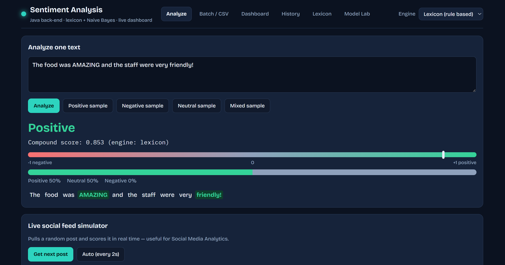
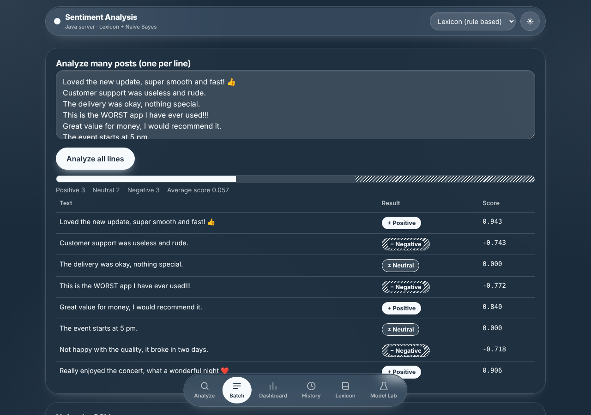
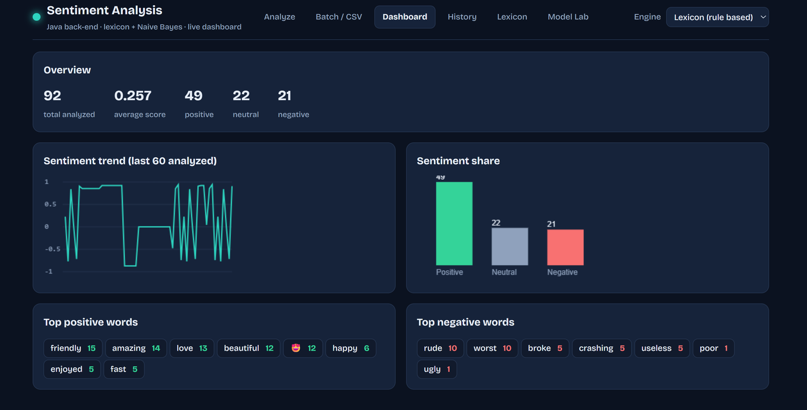
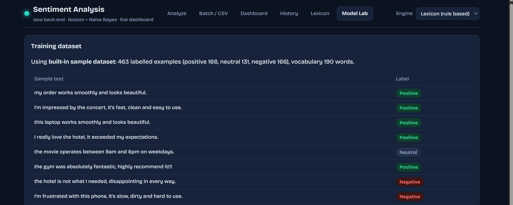

# Sentiment Analysis Web App

Web app that scores any text as positive, neutral or negative with two engines, a word-score lexicon and a Naive Bayes model trained inside the app, and shows the results on a live dashboard.

- **Status:** finished
- **Built:** September 2026
- **Keywords:** Java, HTTP server, Naive Bayes, Sentiment Analysis, JavaScript, Canvas, Social Media Analytics

## Highlights

- Built two analyzers you can switch between while the app runs: Lexicon (word scores, negation, boosters, CAPS, "!" and "but") and Naive Bayes trained from a labelled CSV.
- Added 6 pages: Analyze (highlighted words and a live feed simulator), Batch or CSV, Dashboard, History, Lexicon editor and Model Lab.
- Made the lexicon editable at runtime: change a word score and the next analysis uses it.
- Added Model Lab: upload a `text,label` CSV to retrain, then compare both engines with accuracy, precision, recall, F1 and a confusion matrix.
- Wrote it all in plain Java with no libraries: own HTTP server, own JSON and CSV code, charts on canvas. History and edits are saved as CSV files.

## Screenshots



Analyze: a positive text with its score, and the words that raised it highlighted.



Batch: one post per line, each scored, with the total and the average.



Dashboard: totals, score trend, sentiment share and the top positive and negative words, all computed from the history.



Model Lab: the training dataset behind Naive Bayes (463 labelled examples).

## Tech

- Java 17 or newer: back-end and business logic (`AnalysisService`).
- `com.sun.net.httpserver`: the built-in Java HTTP server, so there is nothing to install.
- Plain HTML, CSS and JavaScript: the 6 pages. Charts are drawn on `<canvas>`.
- CSV files in `data/`: lexicon, training set, feed and history, so everything survives a restart.

## Run it

- Needs: JDK 17 or newer
- Tested on: JDK 21 on Linux (self test: 19 checks pass)

Windows: double-click `run.bat`.

Linux or macOS:

```bash
sh run.sh
```

Then open http://localhost:8080 if the browser does not open by itself.

Self test:

```bash
javac -d out $(find src -name "*.java")
cp -r data web out/
java -cp out sentiment.test.EngineSelfTest
```

More detail is in [docs/GUIDE.md](docs/GUIDE.md).

## Limits and next

- Not done: it runs on your own computer (localhost). There is no hosted version.

## Author

Sachin Kumar | [GitHub](https://github.com/sachinkrcodes) | [LinkedIn](https://www.linkedin.com/in/sachinkrcodes) | Portfolio: [sachinkrcodes.vercel.app](https://sachinkrcodes.vercel.app) | sachinkrcodes@gmail.com

MIT License. See [LICENSE](LICENSE).
